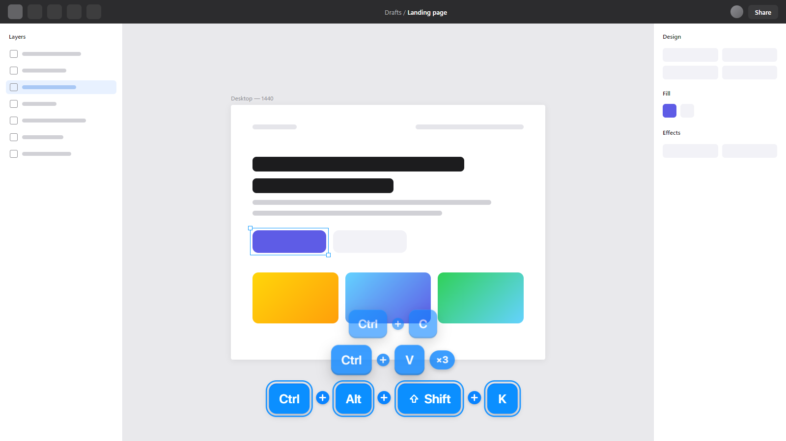
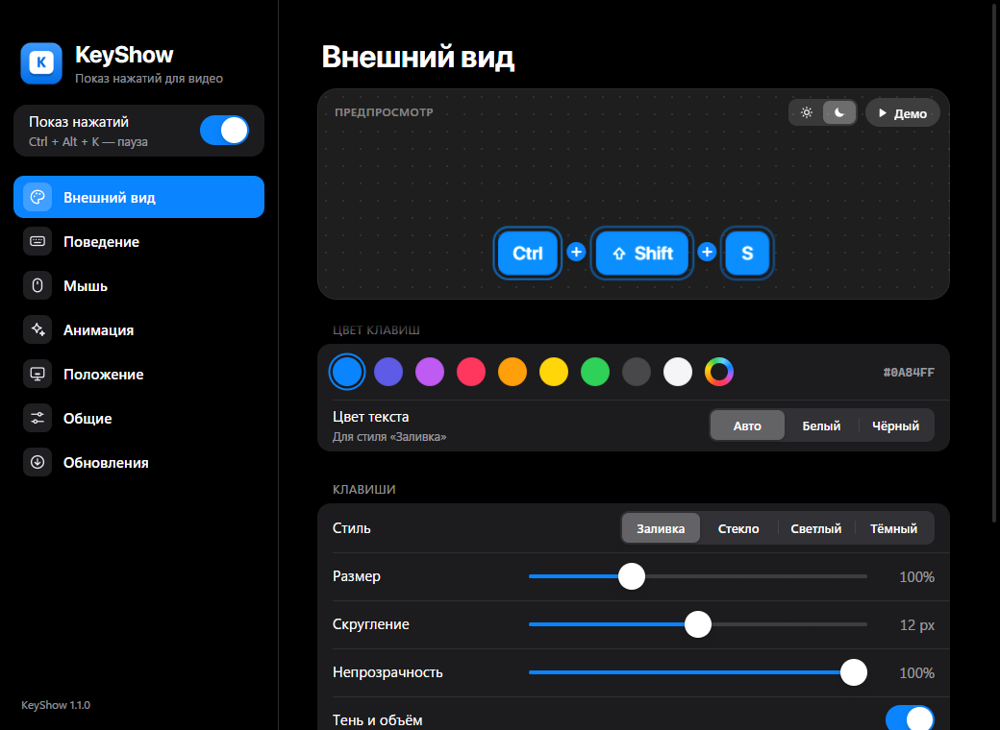
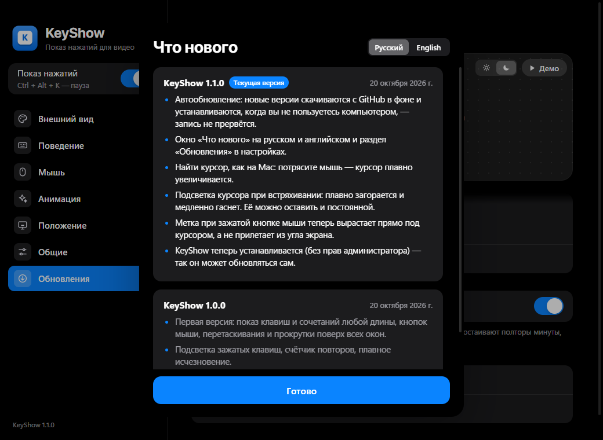
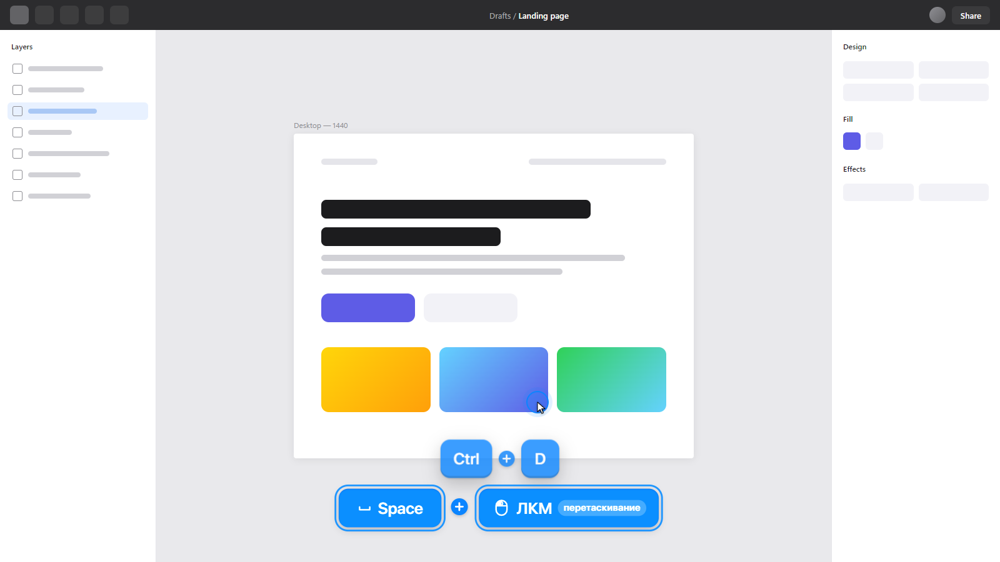
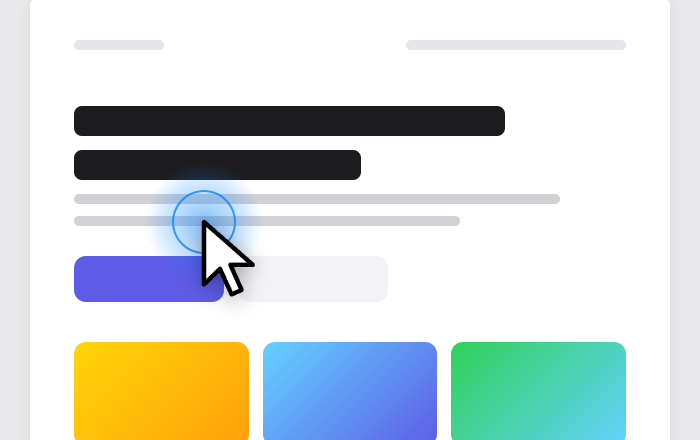
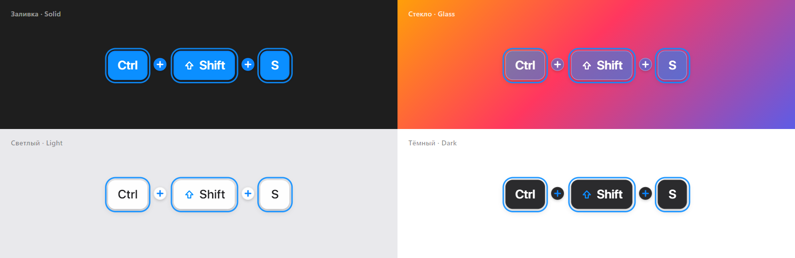
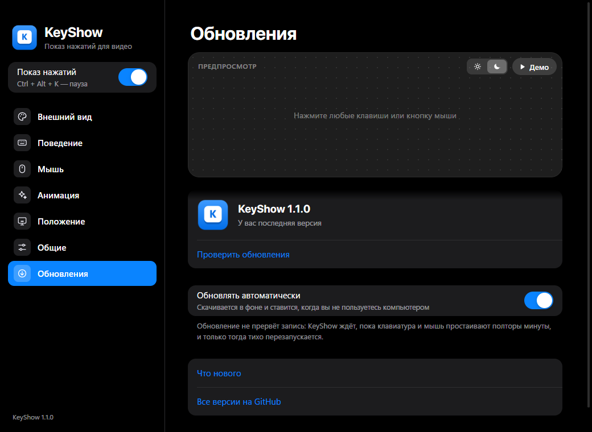
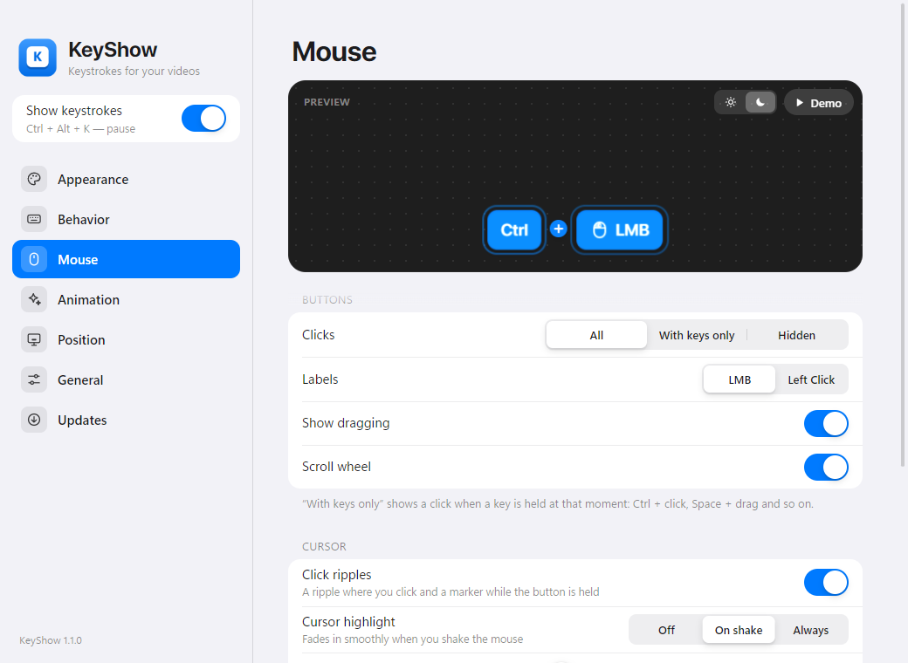
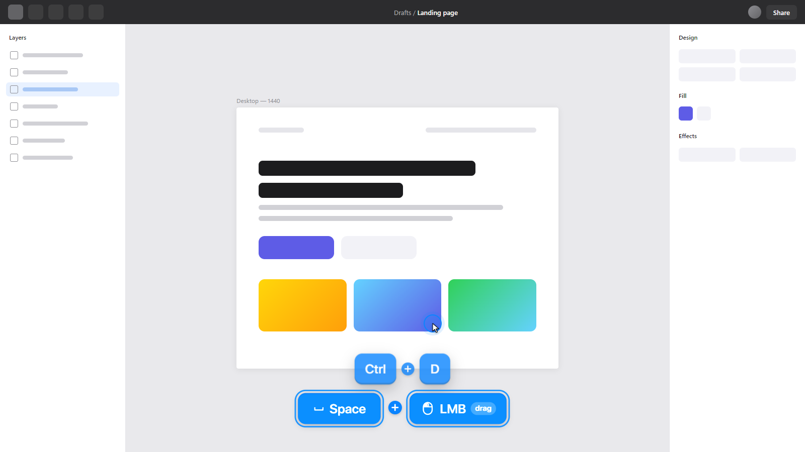

# KeyShow

**RU** · [EN](#english)



Оверлей поверх всех окон для записи обучающих видео (Figma, Photoshop, Illustrator, PowerPoint и т. д.).
Показывает нажатые клавиши и сочетания любой длины (`Ctrl + Alt + Shift + K`), кнопки мыши,
перетаскивание и прокрутку. Пока клавиша зажата, она «вдавлена» и подсвечена; после отпускания
сочетание держится заданное время и плавно растворяется.

## Установка

1. Откройте [Releases](https://github.com/Agrysif/keyshow/releases/latest) и скачайте `KeyShow-Setup-<версия>.exe`.
2. Запустите — установка займёт пару секунд и не требует прав администратора.
   Windows может показать «Windows защитил ваш компьютер» (приложение не подписано) →
   «Подробнее» → «Выполнить в любом случае».

Дальше KeyShow **обновляется сам**: новая версия скачивается в фоне и ставится, когда вы минуту-полторы
не трогаете клавиатуру и мышь, — запись не прервётся. После обновления появится окно «Что нового»
на русском и английском.

## Что умеет

- Сочетания из 2, 3 и более клавиш; модификаторы всегда в порядке Win → Ctrl → Alt → Shift.
- Мышь: ЛКМ / ПКМ / колёсико / боковые кнопки, перетаскивание, прокрутка, круги в месте клика.
- Найти курсор, как на Mac: потрясите мышь — курсор плавно увеличивается, а подсветка под ним
  разгорается и медленно гаснет.
- Счётчик повторов: `Ctrl + Z` три раза → `×3`.
- Фильтры: все клавиши / без набора текста / только сочетания.
- Настройка цвета (по умолчанию синий), стиля, размера, анимации, положения, монитора и многого другого.
- Русский и английский интерфейс — выбирается автоматически по языку Windows, можно переключить вручную.
- Пауза: `Ctrl + Alt + K` — чтобы не показывать в кадре ввод паролей.

## Скриншоты

| Настройки с живым предпросмотром | «Что нового» после обновления |
| --- | --- |
|  |  |
| **Мышь: Space + перетаскивание, метка под курсором** | **Найти курсор: потрясите мышь** |
|  |  |

Стили клавиш — заливка, стекло, светлый и тёмный — на разном фоне:



Раздел «Обновления»: статус, ручная проверка и история версий.



## Советы для записи

- В OBS используйте **«Захват экрана»**, а не «Захват окна» — иначе оверлей не попадёт в кадр.
- Если записываемая программа запущена **от имени администратора**, Windows не даёт видеть нажатия в ней —
  тогда запустите и KeyShow от имени администратора.

---

<a id="english"></a>

**EN**

An always-on-top overlay for recording tutorials. It shows pressed keys and shortcuts of any length,
mouse buttons, dragging and scrolling. Held keys look pressed and glow; after release a shortcut stays
for a moment and smoothly fades away.

**Install:** download `KeyShow-Setup-<version>.exe` from
[Releases](https://github.com/Agrysif/keyshow/releases/latest) and run it (no admin rights needed).
KeyShow then keeps itself up to date: updates download in the background and install while you are
away from the keyboard and mouse, so a recording is never interrupted. A bilingual “What’s New” window
appears after each update.

The interface is available in English and Russian and follows your Windows language by default.

| Settings with a live preview | Mouse: Space + drag |
| --- | --- |
|  |  |

**Tip:** in OBS use *Display Capture*, not *Window Capture*, otherwise the overlay won’t be recorded.

---

## Для разработки / Development

```bash
npm install
```

```bash
npm start
```

Выпуск новой версии / Releasing a new version:

1. Поднимите `version` в `package.json` и добавьте запись в `src/changelog.js` (ru + en).
2. Закоммитьте изменения.
3. Запустите (нужен [GitHub CLI](https://cli.github.com/) с входом в аккаунт):

```bash
npm run release
```

Скрипт соберёт установщик и опубликует релиз — установленные копии KeyShow обновятся сами.

| Файл | Что внутри |
| --- | --- |
| `src/main.js` | Главный процесс: глобальные хуки клавиатуры/мыши, окна, трей, настройки |
| `src/updater.js` | Автообновление через GitHub Releases с установкой в простое |
| `src/engine.js` | Логика сочетаний, удержания, повторов, анимации, эффекты курсора |
| `src/i18n.js` | Тексты интерфейса на русском и английском |
| `src/changelog.js` | История изменений для окна «Что нового» и заметок к релизу |
| `src/keys.js` | Названия и иконки клавиш |
| `src/overlay.*` | Прозрачное окно поверх всех |
| `src/settings.*` | Окно настроек в стиле iOS с живым предпросмотром |
| `scripts/release.js` | Сборка и публикация релиза |
| `scripts/snap.js` | Только для разработки: прогон сценариев и снимки окон (`--screens` обновляет `docs/screenshots`) |
| `scripts/showcase.*` | Сцены для скриншотов README на настоящем движке |
